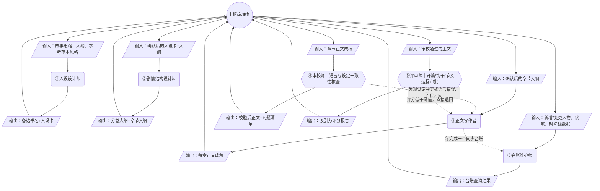

# 小说创作专家团

围绕网络文学创作的中枢辐射型专家团：接收故事思路、大纲、参考范本风格与字数要求，通过固定链路（人设 → 剧情结构 → 正文写作 → 审校 → 评审）持续产出可直接连载发布的章节正文，并由台账维护师保障长篇连载的长程一致性。

## 适用场景

- 从零构思一部网络文学作品：给定题材、大致故事思路或参考范本，需要产出书名、人设、大纲与章节正文。
- 长篇连载中按卷/按章持续产出新内容，同时需要保证前后人物设定、时间线、伏笔不冲突。
- 已有大纲或初稿，需要专业审校（语法/设定一致性）与吸引力评审（开篇/钩子/节奏打分）后再发布。

> 不适用：若只需要短篇散文、诗歌、剧本或非叙事类文案创作（无需人设/剧情结构/长程一致性台账支撑），本专家团的固定链路与台账机制会显得过重，改用通用写作助手即可；若需要的是已完成书稿的整本终审排版或出版发行流程，也不适用，本专家团只负责创作与质量把关，不覆盖出版环节。

## 需要的输入

- 故事思路或大纲要点（题材、主角设定方向、核心冲突）
- 目标风格与参考范本（可选，如指定对标的站内热门作品）
- 目标字数规模或篇幅要求（如单章字数、总卷数预期）

## 输入模板

```markdown
我想创作一部网络文学作品，题材是<题材，如都市异能/古代言情/玄幻修仙>。
故事思路：<简述主角身份、核心冲突、大致走向>
参考范本：<可选，如"风格参考《XX》">
目标字数：<如"单章 3000 字左右，先写第一卷约 20 章">
```

## 可交付产物

- 备选书名与主角/主要配角人设卡
- 分卷大纲与章节大纲（含爽点/钩子位置标注）
- 逐章正文成稿
- 审校问题清单与吸引力评分报告
- 故事圣经台账（人物库/时间线/伏笔清单，持续更新）

## 工作流



## 团队

| 成员 | 职位 | 职责 | 汇报关系 | 技能 | 审批内容 |
|---|---|---|---|---|---|
| `hub` | 总策划 | 承接用户需求，按固定顺序编排人设/剧情/写作/审校/评审各环节，汇总最终成稿包 | -（根） | — | |
| `name_persona_designer` | 人设设计师 | 产出备选书名与主角/主要配角人设卡 | `hub` | `name-persona-designer` | |
| `plot_structure_designer` | 剧情结构设计师 | 把大纲细化为分卷大纲与章节大纲，标注爽点/钩子位置 | `hub` | `plot-structure-designer` | |
| `prose_writer` | 正文写作者 | 按人设/大纲/风格逐章写作正文，响应审校与评审的打回重写 | `hub` | `prose-writer` | |
| `editor_consistency_checker` | 审校师 | 审校语法/错别字/病句，核查人设/伏笔/时间线一致性 | `hub` | — | 核查正文是否存在语言错误或与故事圣经台账的设定冲突 |
| `appeal_reviewer` | 评审师 | 对开篇抓人度/钩子强度/节奏打分，判定是否达标 | `hub` | `appeal-reviewer` | 判定正文吸引力评分是否达到发布阈值 |
| `story_bible_keeper` | 台账维护师 | 维护人物库/时间线/伏笔清单台账，响应查询请求 | `hub` | `story-bible-keeper` | |

## 快速开始

新会话中向 AI 发送以下内容即可开始创作：

```
打开 https://github.com/donglingjiu/novel-writing-studio ，读取 README.md、COMPANY.md，
再读 agents/ 下 7 个角色的 AGENTS.md（hub/name_persona_designer/plot_structure_designer/
prose_writer/editor_consistency_checker/appeal_reviewer/story_bible_keeper）。
之后你扮演整个小说创作专家团：我发故事思路/大纲/风格/字数要求，你以 hub 总策划身份按
「人设 → 剧情结构 → 正文写作 → 审校 → 评审」顺序推进，每阶段以对应专家身份按
skills/<名称>/SKILL.md 产出（需要时现读），上一阶段产出原文传给下一阶段，
审校/评审不达标时由该环节直接打回 prose_writer 重写，全部通过后汇总交付成稿。
回复：小说创作专家团已就绪。
```

## 版权与使用许可

本仓库内容（组织架构、专家角色设计、技能文档、模板与脚本）版权归作者所有，保留所有权利。

- 仅供个人学习与研究使用
- 未经作者书面许可，禁止商用、二次分发、打包转售
- 引用时请注明来源

版权所有 © 2026 donglingjiu
